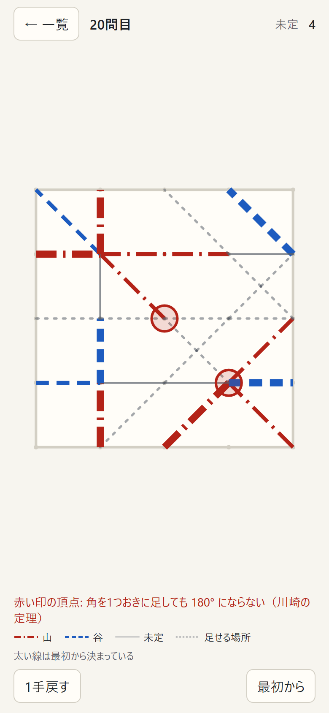
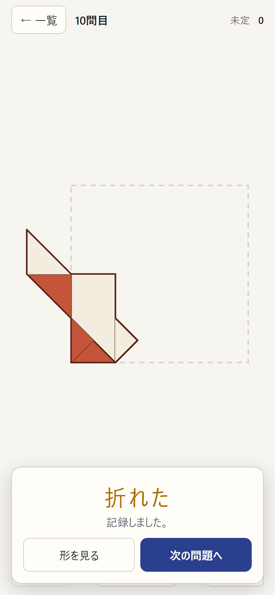
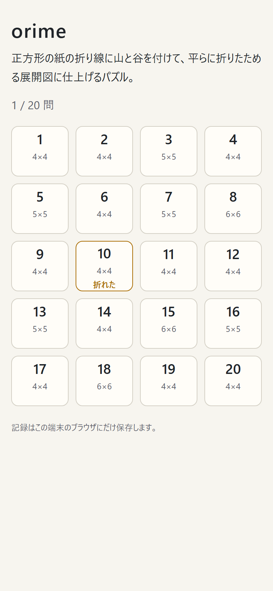

# orime

正方形の紙の展開図に **山折り・谷折り** を付けたり、足りない折り線を足したりして、平らに折りたためる形に仕上げるパズル。
頂点ごとの規則（川崎の定理・前川の定理）だけでなく、重なった紙どうしがぶつからないかまで調べて「折れる」と判定する。全20問。

**アプリ:** 公開後に URL を書く



折り線は格子点どうしを 0°・45°・90° で結ぶものに限る。外部のデータは使わず、判定はすべてブラウザの中で行う。
公開版は Content Security Policy で通信（fetch など）をすべて禁じていて、記録はその端末のブラウザにだけ残る。

## 遊び方

| 折れたところ | 一覧 |
|---|---|
|  |  |

- 線をタップするたびに **山 → 谷 → 未定** と切り替わる。山は赤の一点鎖線、谷は青の破線（折り紙の図の決まりに合わせ、色だけに頼らない）。太い線は最初から決まっていて変えられない
- 1〜10問目は、線がすべて引かれていて、山谷を決める
- 11〜20問目は、薄い点線の **候補線** もある。候補線は **なし → 山 → 谷** と切り替わり、どれを使うかも決める
- 規則を破った頂点には赤い印が付き、理由が出る
  - 角を1つおきに足しても 180° にならない（川崎の定理）
  - 山と谷の本数の差が 2 になっていない（前川の定理）
  - 小さい角を挟む2本が同じ向きで、紙がぶつかる
  - まっすぐな線の途中で山と谷が入れ替わっている
- 頂点はどれも通るのに紙全体では折れないときは「重なった紙どうしがぶつかって折れない」と出る（3問目はこれを体験する問題）
- 折れたら、開いた紙から折り上がった形へ動かして見せる。表は柿色、裏は生成り

## 作りの要点

### 紙を小三角形に分ける

[`src/engine/geom.ts`](src/engine/geom.ts)。正方形の1マスを2本の対角線で4つの直角三角形（小三角形）に分ける。
0°・45°・90° の折り線は必ず小三角形の辺に乗り、折り線での反転は小三角形を別の小三角形の位置へ写す。
そのため、折ったあとに2つの面が重なるかを「同じ位置の小三角形があるか」で調べられ、浮動小数をまったく使わない（頂点は2倍、小三角形の代表点は4倍の整数座標）。

### 頂点ごとの判定

[`src/engine/local.ts`](src/engine/local.ts)。

| 頂点 | 見ること |
|---|---|
| 紙の内側 | 川崎の定理（角を1つおきに足すと 180°）、前川の定理（山と谷の差が 2）、小さい角を挟む2本を山谷逆にして「つぶす」操作を繰り返して2本まで減らせるか |
| 紙の縁 | 両端が開いた扇なので、1次元の折りと同じく「端の折り返し」と「つぶし」で減らせるか |

### 紙全体の判定（重なり順の探索）

[`src/engine/fold.ts`](src/engine/fold.ts)。頂点ごとの判定をすべて通っても、紙全体が平らに折れるとは限らない。
例えば、細い帯を両側の広い面で挟む平行な2本の折り線を同じ向きにすると、広い面どうしがぶつかる（3問目）。これはどの頂点を見ても分からない。

紙全体が平らに折れるかの判定は NP 困難と証明されている（Bern & Hayes 1996）。ここでは盤面が小さいことを使って、正面から探索する。

1. 面（折り線で区切られた小三角形のまとまり）ごとに、折ったあとの位置への写し方を求める。食い違えば形の上で折れない
2. 重なる面の組ごとに「どちらが上か」を変数にする
3. 次の制約を、制約の伝播つきの深さ優先探索で満たす
   - 折り線: 山谷から、隣り合う2面の上下が決まる
   - taco-tortilla: 折り線の位置を内側に含む面は、その折り線の両側の面のあいだに入れない
   - taco-taco: 同じ位置に重なった2本の折り線は、交差して挟み合えない（同じ側なら入れ子か別々、反対側ならどちらかがまるごと上）
   - 推移律: 同じ位置に重なる3面の上下が輪にならない

8×8 の紙を縦横7本ずつで地図のように折る（64枚重ね）展開図で、判定は約0.1秒。

### 候補線と、答えが1つに決まること

[`src/engine/states.ts`](src/engine/states.ts)。決まった線と候補線をすべて引いた紙を作り、辺ごとに 山・谷・未定・なし の状態を持つ。
「なし」の辺を除いた線だけで紙を作り直して、上の判定にかける。

`check:puzzles` は、手がかりから見て折れる状態が **ちょうど1つ** であることを、全部の状態を調べて確かめる（頂点がすべて決まった時点で頂点を調べて枝を刈る）。
あわせて、頂点の判定だけで答えが決まるか（重なりまで考えないと決まらないか）も一覧にする。

### 問題の作り方

[`tools/design.ts`](tools/design.ts)（山谷の問題）と [`tools/design-ghost.ts`](tools/design-ghost.ts)（線を足す問題）。
端から端までの線を無作為に何本か引き、折れる山谷を1つ選ぶ。線を足す問題では、そのうち1〜2本を隠して候補線にし、使わない候補線も混ぜる。
そこから、答えが1つに決まるうちは手がかりを外していく。3問目以外は、頂点の判定だけで答えが決まるように手がかりを残した。

## 確かめ方

| コマンド | 確かめること |
|---|---|
| `npm run check:engine` | 頂点が1つの展開図すべて（6536 通り）で、頂点の判定と紙全体の判定が一致する。45° ずつ8本の頂点で折れる山谷が 112 通り（Hull の 2·C(2n, n−1)）。縦の平行線だけの展開図（808 通り）で、1次元の折りの判定と一致する。無作為な展開図 3000 通りで「紙全体が折れるなら頂点もすべて通る」 |
| `npm run check:puzzles` | 20問すべてで、答えが折れて唯一であること、候補線が決まった線と重ならないこと |
| `npm run e2e` | 公開と同じビルドを画面なしの Chrome で開き、本物のマウス・タッチ・キーボードで操作する（10件）。スマホの指で1問目を解く、3問目のぶつかる案内、候補線の切り替えと11問目、20問目を答えまで操作する、保存できないブラウザでも遊べる、CSP で通信が止まる |

## 扱っていないこと

- 22.5° などの角度の折り線。すべて 0°・45°・90° に限る
- 紙の厚み。厚みのない紙として判定する
- 折る順番。折り上がりの動きは、各小三角形を開いた位置から折った位置へまっすぐ動かす見せ方で、1本の折り線なら真上から見た実際の動きと同じになるが、複数の折り線では途中の重なりは物理的ではない
- 自由に線を引くこと。候補線の中から選ぶ

## 開発

```bash
npm install
npm run dev       # http://localhost:5211/
npm run check     # check:engine・check:puzzles
npm run e2e       # 画面操作のテスト
npx tsx tools/design.ts random 4 7 300 local     # 山谷の問題の下調べ（大きさ 4、線は最大 7 本、300 回）
npx tsx tools/design-ghost.ts 4 7 4000           # 線を足す問題の下調べ
npm run build && npm run preview                 # 公開版を http://localhost:5212/ で確かめる
npm run screenshots                              # 公開版から docs/images/ の画像を撮る
```
